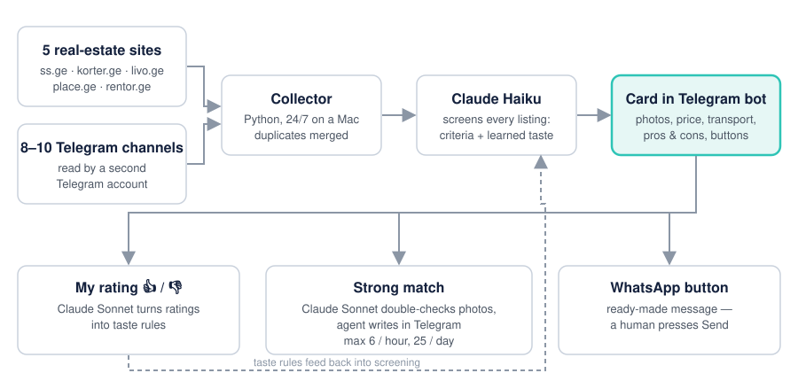
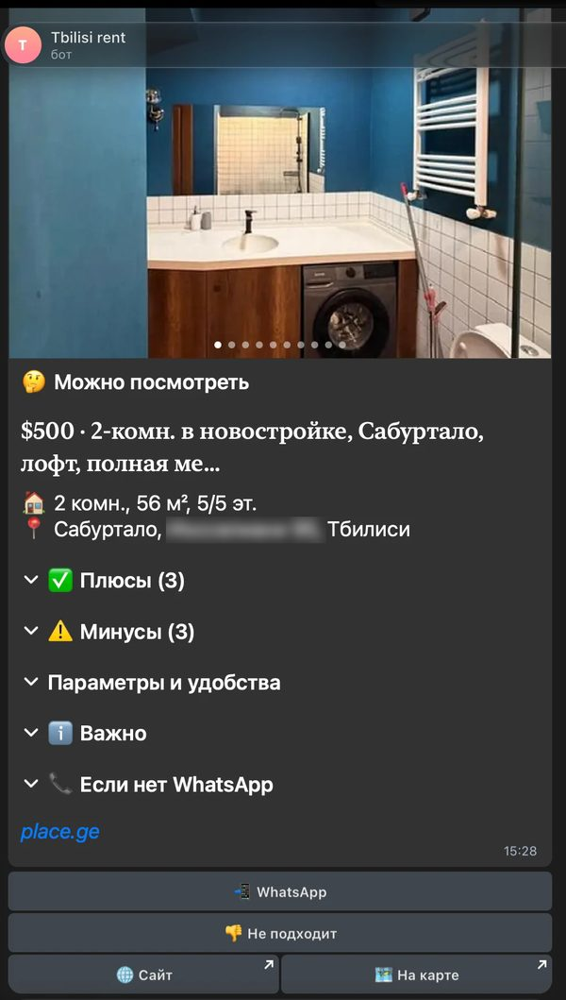

# Tbilisi Rent Agent

**An AI agent that searched for a rental apartment in Tbilisi for me — and found one in 1.5 weeks.**

[English](#english) · [Українська](#українська)



<p align="center"></p>
<p align="center"><sub>A real card from the bot (the street address is blurred). The original bot spoke Russian; the published code is translated to Ukrainian.<br>Справжня картка з бота (адресу розмито). Оригінальний бот був російською; опублікований код перекладено українською.</sub></p>

---

## English

### What it does

A personal agent written in Python that ran 24/7 on my Mac. It:

- **monitors 5 real-estate sites** (ss.ge, korter.ge, livo.ge, place.ge, rentor.ge) and **8–10 Telegram channels** (read by a second Telegram account);
- **screens every listing with Claude** against my criteria: price, district, heating, furniture and — from the photos — the actual condition of the flat;
- **sends the matches to my Telegram bot** as cards: photo slideshow, price, nearest metro and travel time to the centre, pros and cons, what to ask the landlord;
- **contacts landlords**: for WhatsApp it prepares a message and a button (I press *Send* myself); in Telegram it writes on its own, but only for strong matches and within strict limits;
- **learns my taste**: every 👎 with a reason goes into the history, and Claude turns it into rules for the next screenings.

### Results (12–22 November 2026)

| Metric | Value |
|---|---|
| Listings processed | **6,569** |
| Matching cards sent to the bot | **197** |
| Messages to landlords sent automatically | **11** |
| My ratings the agent learned from | **53** |
| **Outcome** | **Apartment found in 1.5 weeks for $500/month, while similar flats start at $700** |

After that the agent was switched off (24 November 2026). The code is published as a portfolio project.

### How it works

1. **Collect.** Sites are checked every ~12 minutes, one page at a time with pauses, like a regular visitor. Telegram posts arrive in real time. The same flat posted on several sites is recognised (same phone and price, or same location, price and area) and merged into one card.
2. **Screen — Claude Haiku.** Each listing (text, up to 10 photos, the linked listing page) is evaluated against [`criteria.md`](src/tbilisi_agent/criteria.md) with a strict JSON schema: verdict `strong / maybe / reject`, condition score 1–10 based on the *worst* photo, price, address, pros and cons.
3. **Deliver.** `maybe` and `strong` matches become a card in the bot. The address is geocoded (OpenStreetMap) to show the nearest metro, bus stop and time to the centre.
4. **Double-check — Claude Sonnet.** Before the agent writes to anyone by itself, a second, stricter model re-checks the photos. Any doubt or error → no automatic message, the decision goes to the human.
5. **Learn.** Ratings and reasons (“old renovation”, “far from metro”, or free text) are summarised by Claude into taste rules that are added to every next evaluation.

### Design decisions

- **Two models.** The cheap model (Haiku) looks at everything; the stronger one (Sonnet) is used only where a mistake costs more — before messaging a real person. Monthly API spend was capped at $10.
- **Human in the loop.** WhatsApp messages are never sent automatically. Automatic Telegram messages: only for `strong` matches with condition ≥ 8/10, max 6 per hour and 25 per day — messengers restrict accounts that spam strangers.
- **Prompt-injection defence.** Listing text is wrapped as data, and the model is told to ignore any instructions inside it. Output is forced into a JSON schema.
- **Safe fetching.** Only public `http(s)` addresses are opened (no local network), every redirect is re-checked, pages are read up to 2 MB.
- **Respecting sites.** No bypassing of bot protection: myhome.ge is not scraped because it is protected; phone numbers hidden behind buttons are not extracted.
- **Secrets.** API keys, the bot token and the Telegram session live only in the macOS Keychain — never in files or code.
- **Graceful failures.** If Claude does not answer, a site listing is retried later (up to 3 times); network errors never crash the agent.

### Tech stack

Python 3.12 · Claude API (Haiku + Sonnet, structured JSON output, vision) · Telethon (Telegram client API) · Telegram Bot API · SQLite · OpenStreetMap (Nominatim, Overpass) · macOS Keychain · launchd · uv with pinned dependencies

### Project structure

| File | Role |
|---|---|
| `main.py` | Main loop: Telegram channels and sites → evaluation → card or message |
| `judge.py` | Prompts and JSON schemas for Claude, second check, learning taste rules |
| `ssge.py`, `sites.py` | Reading the five real-estate sites |
| `pages.py` | Safe fetching of listing pages: contacts, coordinates, “is it still active” |
| `geo.py` | Nearest metro, bus stop and travel time to the centre |
| `bot.py` | Telegram bot: cards, buttons, menu, several participants |
| `compose.py` | Messages to landlords (first / repeated / follow-up) |
| `db.py` | Memory: seen listings, contacts, rate limits, feedback |
| `setup.py` | One-time setup: Telegram login by QR, bot pairing, autostart |
| `criteria.md` | Search criteria — an example, replace with your own |

### Running it (macOS)

```bash
uv sync --frozen
security add-generic-password -a "$USER" -s tbilisi-agent-anthropic -w   # paste your Claude API key
uv run tbilisi-agent-setup   # Telegram app keys, second account login by QR, bot pairing, autostart
```

You need: a Claude API key, Telegram API keys from my.telegram.org, a second Telegram account and a bot from @BotFather.

### Notes

- **Language.** Code comments, prompts and the bot interface are in Ukrainian. Messages to landlords are in Russian on purpose — that is the language most landlords in Tbilisi use.
- **Built with Claude Code.** I defined the task, the architecture and the safety rules (limits, human in the loop, no bypassing of protections), reviewed and tested the result and ran the agent; Claude Code wrote most of the code.

**Author:** Yehor Kryvuliako — AI automation, Claude Code · Telegram [@egor_physio](https://t.me/egor_physio)

---

## Українська

### Що робить

Особистий агент на Python, який цілодобово працював на моєму Mac. Він:

- **стежить за 5 сайтами нерухомості** (ss.ge, korter.ge, livo.ge, place.ge, rentor.ge) і **8–10 Telegram-каналами** (їх читає другий акаунт Telegram);
- **оцінює кожне оголошення через Claude** за моїми критеріями: ціна, район, опалення, меблі і — за фото — реальний стан квартири;
- **надсилає відповідні варіанти в мій Telegram-бот** картками: слайдшоу фото, ціна, найближче метро й час до центру, плюси й мінуси, що спитати в орендодавця;
- **пише орендодавцям**: для WhatsApp готує текст і кнопку («Надіслати» натискаю я сам); у Telegram пише сам, але лише за сильними варіантами й у суворих лімітах;
- **вчиться на моєму смаку**: кожне 👎 із причиною потрапляє в історію, і Claude перетворює її на правила для наступних відборів.

### Результати (12–22 листопада 2026)

| Показник | Значення |
|---|---|
| Оброблено оголошень | **6 569** |
| Відповідних карток у бот | **197** |
| Повідомлень орендодавцям агент надіслав сам | **11** |
| Моїх оцінок, на яких він вчився | **53** |
| **Підсумок** | **Квартиру знайдено за 1,5 тижня за $500/міс, хоча схожі на ринку — від $700** |

Після цього агента вимкнено (24 листопада 2026). Код опубліковано як проєкт для портфоліо.

### Як працює

1. **Збір.** Сайти перевіряються раз на ~12 хвилин, по одній сторінці з паузами, як звичайний відвідувач. Пости з Telegram приходять наживо. Та сама квартира з кількох сайтів розпізнається (той самий телефон і ціна або те саме місце, ціна й площа) і склеюється в одну картку.
2. **Відбір — Claude Haiku.** Кожне оголошення (текст, до 10 фото, сторінка за посиланням) оцінюється за [`criteria.md`](src/tbilisi_agent/criteria.md) із суворою JSON-схемою: вердикт `strong / maybe / reject`, стан 1–10 за *найгіршим* фото, ціна, адреса, плюси й мінуси.
3. **Картка.** Варіанти `maybe` і `strong` стають карткою в боті. Адреса переводиться в координати (OpenStreetMap), щоб показати найближче метро, зупинку і час до центру.
4. **Друга перевірка — Claude Sonnet.** Перш ніж агент сам комусь напише, друга, суворіша модель ще раз дивиться фото. Будь-який сумнів чи помилка → автоматичного повідомлення немає, рішення за людиною.
5. **Навчання.** Оцінки й причини («старий ремонт», «далеко від метро» або вільний текст) Claude зводить у правила смаку, які додаються до кожної наступної оцінки.

### Рішення, які я ухвалив

- **Дві моделі.** Дешева (Haiku) дивиться все; сильніша (Sonnet) — лише там, де помилка дорожча: перед повідомленням живій людині. Витрати на API обмежено $10 на місяць.
- **Людина в контурі.** У WhatsApp агент сам ніколи не пише. Автоповідомлення в Telegram — лише для `strong` зі станом від 8/10, не більше 6 на годину й 25 на добу: месенджери обмежують акаунти, що пишуть незнайомцям масово.
- **Захист від prompt injection.** Текст оголошення передається як дані, і модель має ігнорувати будь-які вказівки всередині. Відповідь — лише за JSON-схемою.
- **Безпечне завантаження сторінок.** Відкриваються лише публічні адреси `http(s)` (не локальна мережа), кожна переадресація перевіряється, сторінка читається до 2 МБ.
- **Повага до сайтів.** Захист від роботів не обходимо: myhome.ge не читаємо, бо він захищений; телефони, сховані за кнопками, не дістаємо.
- **Секрети.** Ключі API, токен бота й сесія Telegram зберігаються лише у зв'язці ключів macOS — ніколи у файлах чи коді.
- **Стійкість до збоїв.** Якщо Claude не відповів, оголошення із сайту перевіряється пізніше (до 3 разів); помилки мережі не зупиняють агента.

### Технології

Python 3.12 · Claude API (Haiku + Sonnet, структурована JSON-відповідь, аналіз фото) · Telethon (клієнтський API Telegram) · Telegram Bot API · SQLite · OpenStreetMap (Nominatim, Overpass) · зв'язка ключів macOS · launchd · uv із закріпленими версіями залежностей

### Примітки

- **Мова.** Коментарі в коді, промпти й інтерфейс бота — українською. Повідомлення орендодавцям — свідомо російською: нею спілкується більшість орендодавців у Тбілісі.
- **Зроблено з Claude Code.** Задачу, архітектуру й правила безпеки (ліміти, людина в контурі, жодного обходу захисту) визначав я, перевіряв і тестував результат і запускав агента теж я; більшість коду написав Claude Code.

**Автор:** Єгор Кривуляко — AI-автоматизація, Claude Code · Telegram [@egor_physio](https://t.me/egor_physio)
